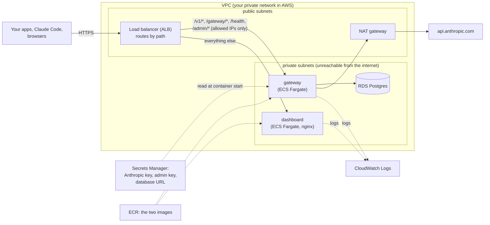
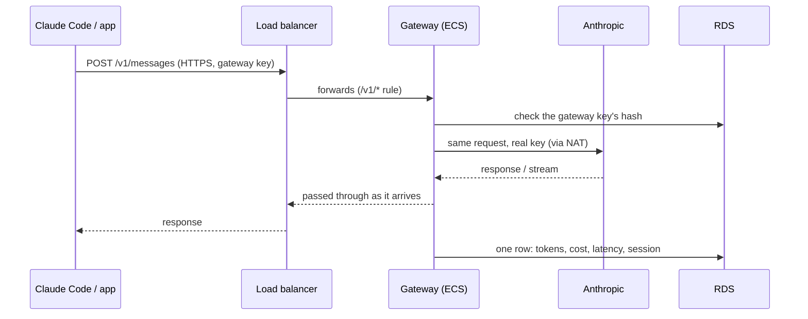
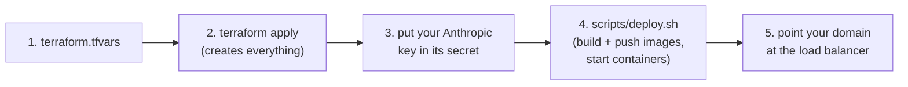

# Deploying to AWS (ECS Fargate + RDS)

This guide puts the gateway and dashboard on AWS with Terraform (the code is in
[`infra/`](../infra)), so your apps and your team can use it from anywhere over HTTPS.
For running it on your own machine instead, see [USAGE.md](USAGE.md).

- [1. What gets created](#1-what-gets-created)
- [2. Before you start](#2-before-you-start)
- [3. Deploy, step by step](#3-deploy-step-by-step)
- [4. Use it](#4-use-it)
- [5. Day-to-day operations](#5-day-to-day-operations)
- [6. Security choices](#6-security-choices)
- [7. Cost, and tearing it down](#7-cost-and-tearing-it-down)
- [8. Troubleshooting](#8-troubleshooting)

## 1. What gets created



| Piece | What it is, in plain words | Terraform |
|---|---|---|
| **VPC + subnets** | A private network. *Public* subnets can talk to the internet; *private* ones can't be reached from it. Two of each, in two data centers (availability zones). | `modules/network` |
| **NAT gateway** | A one-way door: lets the private containers call Anthropic without anything being able to call in. | `modules/network` |
| **RDS Postgres** | The database, run by AWS: patched, backed up daily (kept 7 days), encrypted. Only the gateway can connect. | `modules/database` |
| **Secrets Manager** | A safe for the Anthropic key, the admin key, and the database URL. ECS hands them to the gateway as environment variables when it starts. They're never in an image or a file. | `main.tf`, `modules/database` |
| **ECR** | A private registry (like Docker Hub) for our two images. | `modules/app` |
| **ECS Fargate** | Runs our containers without us managing servers. A *service* keeps the set number of containers running and replaces failed ones. | `modules/app` |
| **ALB** | The load balancer: the single public entrance, holds the HTTPS certificate, and sends each path to the right service. | `modules/app` |
| **CloudWatch Logs** | Where the containers' logs go (kept 14 days). | `modules/app` |

The path of one call:



## 2. Before you start

You need:

1. **An AWS account**, with the AWS CLI signed in (`aws sts get-caller-identity` shows
   who you are) as a user allowed to create the resources above.
2. **Terraform 1.10+** (`brew install terraform`) and **Docker** (to build the images).
3. **A domain name for HTTPS** (strongly recommended), e.g. `gateway.example.com`, and
   an **ACM certificate** for it in the same region:

   ```bash
   aws acm request-certificate --domain-name gateway.example.com --validation-method DNS
   aws acm describe-certificate --certificate-arn <arn from above> \
     --query 'Certificate.DomainValidationOptions[0].ResourceRecord'
   ```

   Add the CNAME record it shows at your DNS provider, then wait until
   `aws acm describe-certificate ... --query Certificate.Status` says `ISSUED`.

   Without a certificate the stack still works over plain HTTP, but gateway keys and
   Claude Code logins would then cross the internet unencrypted: use that only for a
   short first try.

## 3. Deploy, step by step



**1. Settings.** In `infra/`:

```bash
cd infra
cp terraform.tfvars.example terraform.tfvars
```

Edit `terraform.tfvars`: set `certificate_arn`, set `admin_cidrs` to your own address
(`curl -s ifconfig.me`, then add `/32`) so only you can open the full dashboard, and
choose `gateway_settings` (for example `STORE_CONTENT = "true"` for handoffs). All
variables are described in `variables.tf`.

**2. Create the infrastructure.**

```bash
terraform init          # downloads the AWS provider (once)
terraform plan          # shows what will be created; nothing changes yet
terraform apply         # type "yes"; the database takes the longest
```

Until steps 3 and 4 are done, the ECS services can't start their containers (there's no
image yet), so failing tasks in the ECS console at this point are expected.

**3. Your Anthropic key.** Terraform made an empty secret for it, so the key never
appears in Terraform's files or state:

```bash
aws secretsmanager put-secret-value \
  --secret-id "$(terraform output -raw anthropic_key_secret)" \
  --secret-string 'sk-ant-...'
```

(To keep the key out of your shell history, start the line with a space; in zsh that
needs `setopt HIST_IGNORE_SPACE`.)

**4. Build, push, and start.**

```bash
./scripts/deploy.sh
```

It logs in to ECR, builds both images for ARM64 (the Graviton processors the tasks run
on), pushes them, tells ECS to start containers from them, and waits until the load
balancer reports them healthy. The gateway migrates the database as it starts.

**5. DNS.** At your DNS provider, add a CNAME from `gateway.example.com` to the load
balancer's name (`terraform output url` shows it; with Route 53, use an alias record).

Check it:

```bash
curl -s https://gateway.example.com/health      # {"status":"ok"}
```

## 4. Use it

**Sign in to the dashboard** at `https://gateway.example.com` with the admin key:

```bash
$(terraform output -raw admin_key_command)
```

**Create keys** for people and apps. The database is private, so keys are made through
the gateway's admin API, from an allowed address:

```bash
export GW_ADMIN_KEY="$($(terraform output -raw admin_key_command))"
gw keys --url https://gateway.example.com create alice      # prints alice's key once
gw keys --url https://gateway.example.com list
gw keys --url https://gateway.example.com revoke gw_AbCdEfG
```

**Connect**, exactly as with a local gateway ([USAGE.md](USAGE.md#4-send-your-apps-through-it)):

```bash
gw login https://gateway.example.com     # paste the key at the hidden prompt
gw claude                                # Claude Code through the deployed gateway
eval "$(gw env)"                         # SDK apps in this terminal
```

## 5. Day-to-day operations

| Task | How |
|---|---|
| **Ship new code** | `infra/scripts/deploy.sh`. ECS starts new containers, waits for them to be healthy, then drains the old ones (in-flight calls get up to 60s to finish). A release whose containers keep failing is rolled back automatically. |
| **Change a setting** | Edit `gateway_settings` in `terraform.tfvars`, then `terraform apply`. That creates a new task definition revision and ECS rolls onto it. |
| **Read logs** | `aws logs tail "$(terraform output -raw gateway_log_group)" --follow` |
| **Replace the Anthropic key** | `put-secret-value` as in step 3, then redeploy (`deploy.sh`), because secrets are read when a container starts. |
| **Replace the admin key** | `terraform apply -replace=random_password.admin_api_key`, then redeploy. |
| **Run more than one gateway** | Set `gateway_count`. With more than one, containers no longer migrate on start (several at once could collide): run `scripts/migrate.sh` after `deploy.sh` pushes a release with new migrations. Each container also runs the background categorizer, so a session may occasionally be classified twice (about $0.0001 each). |
| **Restore the database** | RDS keeps daily backups for 7 days and can restore to any point in that window (console: RDS → the database → Actions → Restore to point in time). It restores into a *new* database; point the `database-url` secret at it and redeploy. |
| **Database credentials** | The `<project>/database-url` secret in Secrets Manager. |

## 6. Security choices

- **Only the load balancer is public.** The containers and the database are in private
  subnets, and each security group (firewall) admits only the layer in front of it:
  internet → ALB → containers → database.
- **HTTPS with TLS 1.2+** at the load balancer; port 80 only redirects.
- **The admin API is limited to `admin_cidrs`** at the load balancer, before a request
  reaches the gateway. Users' own pages (`/gateway/*`) aren't limited, because each is
  scoped to the caller's key.
- **Secrets stay out of code and images.** The Anthropic key never touches Terraform. The
  admin key and database password are generated by Terraform, so they are in its state:
  keep state in an encrypted S3 bucket (see [`infra/backend.tf`](../infra/backend.tf)),
  not on a laptop.
- **The database:** encrypted at rest, TLS in transit (`ssl=require`), backups on,
  deletion protection on.
- **Least privilege:** the containers' only AWS permission is the execution role ECS uses
  to pull images, write logs, and read these three secrets. The app itself has no AWS
  permissions.
- **Images are scanned** for known vulnerabilities when pushed (ECR scan on push).
- **With `STORE_CONTENT=true`**, every user's prompts are in the database: tell users,
  and keep database access limited.

Not included, worth adding for real production: a WAF with rate limiting in front of the
load balancer, CloudWatch alarms (5xx rate, unhealthy targets, database CPU and storage),
and a NAT gateway per availability zone.

## 7. Cost, and tearing it down

What is billed while the stack exists, whether or not it's used: the NAT gateway, the
load balancer, the RDS instance and its storage, the Fargate containers (two: 0.5 vCPU
and 0.25 vCPU), public IPv4 addresses (the NAT's and the load balancer's), three secrets,
and logs. Get current figures for
your region from the [AWS Pricing Calculator](https://calculator.aws/). Anthropic usage
is billed separately, as always.

To delete everything:

```bash
# 1. allow the database to be deleted
#    terraform.tfvars:  db_deletion_protection = false
terraform apply
# 2. delete
terraform destroy
```

RDS keeps a final snapshot (`<project>-final`) as a last copy of the data; delete it in
the RDS console when you no longer need it.

## 8. Troubleshooting

| Symptom | Likely cause and fix |
|---|---|
| Tasks stop with `CannotPullContainerError` | No image pushed yet: run `scripts/deploy.sh`. |
| Tasks stop with `ResourceInitializationError ... secret` | The Anthropic key secret has no value yet: do step 3, then `deploy.sh`. |
| `502 Bad Gateway` right after a deploy | Containers are still starting; give it a minute. If it persists, read the gateway's logs. |
| `503` from the load balancer | No healthy containers. `aws ecs describe-services --cluster <cluster> --services gateway --query 'services[0].events[:5]'` says why. |
| `403 the admin API is not reachable from this address` | Your IP isn't in `admin_cidrs` (it may have changed): update it and `terraform apply`. |
| `504` on a long call | The call took longer than `request_timeout_s` (600s). Raise it, and use streaming for long generations. |
| The gateway logs a database connection error | Check the `database-url` secret, and that the database is `available` in the RDS console. |

What to look at, in order: the service's **events** (why ECS stopped a task), then the
container **logs** (what the app said), then the **target group health** in the EC2
console (what the load balancer sees).
