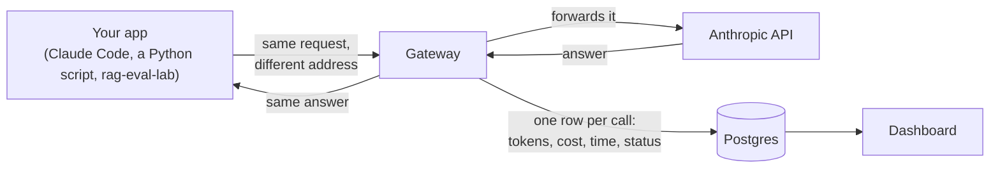
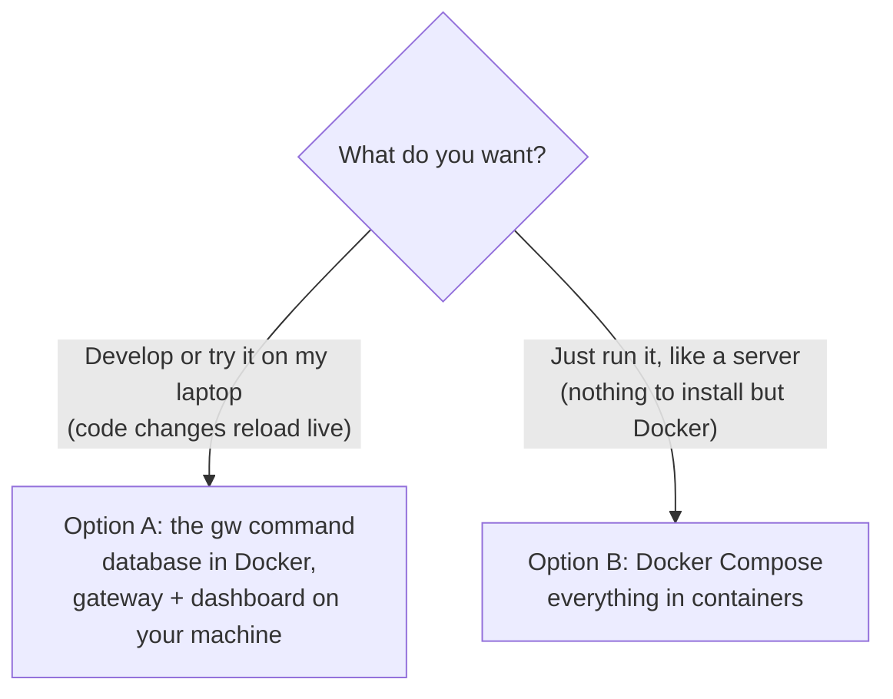
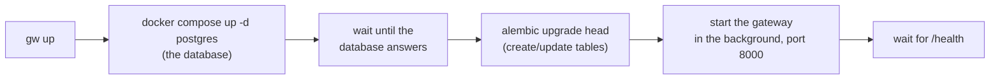
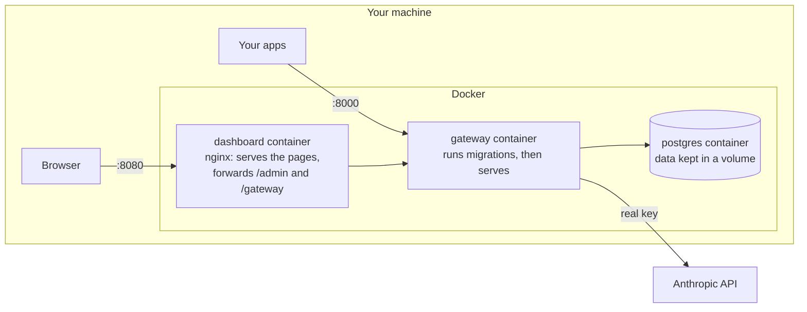
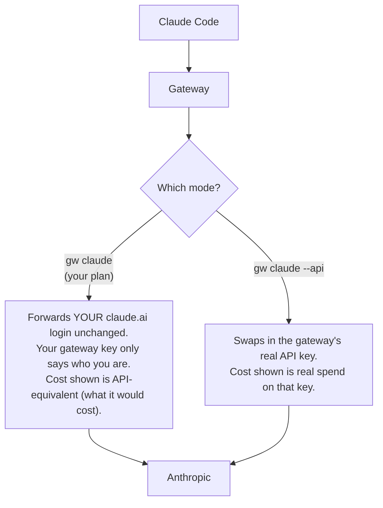
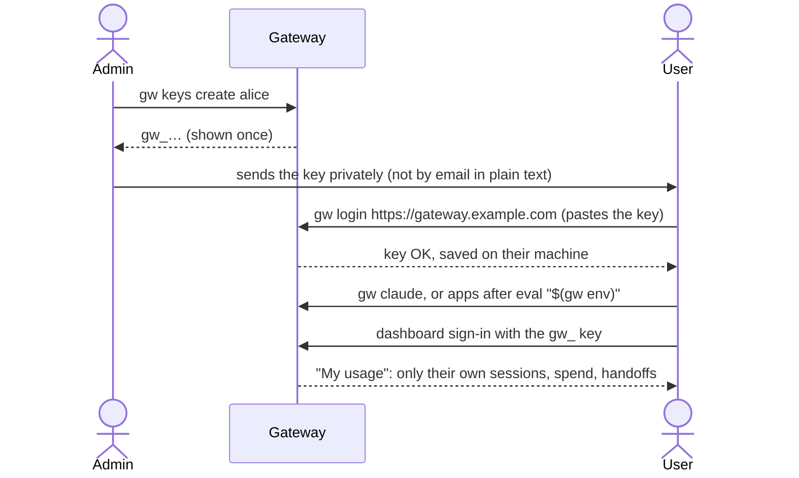
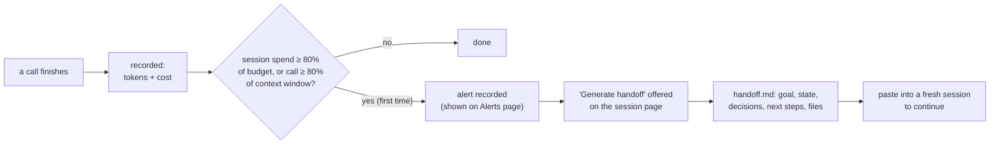

# Using llm-gateway-lab

A step-by-step guide: what the gateway is, how to set it up, how to send your apps and
Claude Code through it, and how to read the dashboard. No prior knowledge of the code is
needed. For how each part works inside, see the [README](../README.md); for the measured
results, [EVALUATION.md](EVALUATION.md).

- [1. The idea in one picture](#1-the-idea-in-one-picture)
- [2. Words you'll see](#2-words-youll-see)
- [3. Set it up (operator)](#3-set-it-up-operator)
- [4. Send your apps through it](#4-send-your-apps-through-it)
- [5. Give someone else access](#5-give-someone-else-access)
- [6. The dashboard](#6-the-dashboard)
- [7. Budgets, alerts, and handoffs](#7-budgets-alerts-and-handoffs)
- [8. Privacy: what gets stored](#8-privacy-what-gets-stored)
- [9. Troubleshooting](#9-troubleshooting)
- [10. Cheat sheet](#10-cheat-sheet)

## 1. The idea in one picture

Normally an app talks to Anthropic directly. With the gateway, the app talks to the
gateway instead, and the gateway passes the call on. Because every call goes through it,
the gateway can write down exactly what each call used and cost.



The app doesn't change, except for the address it sends calls to. Its replies are the
same, because the gateway forwards requests and responses unchanged.

## 2. Words you'll see

| Word | Meaning |
|---|---|
| **Gateway** | The program in `gateway/` that sits between your apps and Anthropic. Runs on port 8000. |
| **Anthropic API key** (`sk-ant-…`) | The real key that Anthropic bills. Only the gateway has it, in `.env`. |
| **Gateway key** (`gw_…`) | A key the gateway gives out, one per person or app. Apps use it instead of the real key. Shown once when created; the gateway stores only a fingerprint (hash) of it. |
| **Admin key** | The password for the full dashboard and the `/admin` API (`ADMIN_API_KEY` in `.env`). Only the operator has it. |
| **Operator / admin** | Whoever runs the gateway. Sees everyone's usage. |
| **User** | Someone with a gateway key. Sees only their own usage. |
| **Session** | A group of calls that belong together, e.g. one Claude Code conversation. |
| **Handoff** | A document summarizing a session so a fresh session can pick up where it left off. |
| **Docker / container** | A way to run a program with everything it needs packaged together, so it runs the same on any machine. |
| **Migration** | A script that creates or updates the database tables. Runs automatically on start. |

## 3. Set it up (operator)

There are two ways to run it on one machine. Pick one; they use the same ports, so
don't run both at once. To host it on AWS for a team, see [DEPLOY.md](DEPLOY.md).



### Before either option

1. Install **Docker Desktop** and start it (the whale icon in the menu bar).
2. Get the code and create your settings file:

   ```bash
   git clone https://github.com/akhilyenisetty/llm-gateway-lab.git
   cd llm-gateway-lab
   cp .env.example .env
   ```

3. Open `.env` and set `ANTHROPIC_API_KEY` to your real key from
   [console.anthropic.com](https://console.anthropic.com). Every other setting has a
   working default and is explained in the file. `.env` is never committed to git.

### Option A: the `gw` command (for development)

Needs Python 3.11 and Node.js 20.19 or newer, in addition to Docker.

```bash
python3.11 -m venv .venv
.venv/bin/pip install -e ".[dev]"
ln -s "$(pwd)/.venv/bin/gw" ~/.local/bin/gw   # so `gw` works from any folder (once)

gw up           # starts Postgres, creates the tables, starts the gateway
gw dashboard    # installs the dashboard the first time, then opens it in the browser
gw admin-key --copy   # copies the admin key; paste it into the dashboard's sign-in
```

What `gw up` does, step by step:



`gw status` shows what's running; `gw logs` follows the gateway's log; `gw restart`
applies changes to `.env`; `gw down` stops everything (`gw down --db` stops the
database too; your data stays).

### Option B: Docker Compose (everything in containers)

Only Docker is needed.

```bash
docker compose --profile app up -d --build
```

The first run takes a few minutes (it builds the images). Then:

| Open | What |
|---|---|
| http://localhost:8080 | the dashboard |
| http://localhost:8000 | the gateway (point apps here) |



Useful commands:

```bash
docker compose --profile app ps                 # what's running
docker compose --profile app logs -f gateway    # follow the gateway's log
docker compose --profile app up -d              # after editing .env: recreates containers
docker compose --profile app down               # stop (data is kept)
docker compose exec gateway python -m gateway.keys create --name alice   # a gateway key
grep ADMIN_API_KEY .env                         # the dashboard sign-in key (set it first)
```

If a port is taken, change it in `.env`: `GATEWAY_PORT=8001`, `DASHBOARD_PORT=8081`,
`POSTGRES_PORT=5433`.

### Check that it works

```bash
curl -s localhost:8000/health        # {"status":"ok"}
```

Then send one call (section 4) and watch it appear on the dashboard's Overview page.

## 4. Send your apps through it

Every app needs two things: the gateway's **address** and a **gateway key**.

### Claude Code

```bash
gw claude              # on your claude.ai plan (Pro/Max): your plan pays
gw claude --api        # on the gateway's Anthropic API key: billed per token
gw claude --budget 2   # either way, with a $2 budget for this session
```

The difference is who pays:



Anything after `gw claude` goes to Claude Code, e.g. `gw claude --model haiku`.
Without `gw`, the same thing by hand (see the README's
[Claude Code section](../README.md#claude-code-through-the-gateway)):

```bash
ANTHROPIC_BASE_URL=http://localhost:8000 \
ANTHROPIC_CUSTOM_HEADERS="X-Gateway-Key: gw_..." \
CLAUDE_CODE_GATEWAY_HINT_HEADERS=1 claude
```

### Any app using the Anthropic SDK (Python, TypeScript, …)

The SDKs read two environment variables, so most apps need no code change:

```bash
eval "$(gw env)"     # sets ANTHROPIC_BASE_URL and ANTHROPIC_API_KEY in this terminal
python my_app.py     # now goes through the gateway
```

`gw env` prints the two lines it sets, so you can also copy them into an app's own
`.env`. To label calls on the dashboard, add headers (all optional):

```python
client = anthropic.Anthropic(
    default_headers={
        "X-App": "my-app",  # which app (shown on the dashboard)
        "X-Session-Id": "run-42",  # group these calls into one session
        "X-Category": "analysis",  # tag the kind of work
    }
)
```

Without `X-Session-Id`, the gateway groups calls by conversation on its own: every turn
of a conversation repeats its first message, so it uses a fingerprint of that.

### Example: rag-eval-lab

[rag-eval-lab](https://github.com/akhilyenisetty/rag-eval-lab) already uses
`anthropic.Anthropic()`, so it routes through the gateway with no other change. It labels
its calls `X-App: rag-eval-lab`, and `GATEWAY_SESSION_ID` groups one run's calls into
one session:

```bash
eval "$(gw env)"
cd ../rag-eval-lab
GATEWAY_SESSION_ID=eval-$(date +%Y%m%d-%H%M) python -m rag_eval.evaluate --golden data/eval/golden_hard.jsonl
```

The run then shows up as one session, with its total cost, on the dashboard.

### Raw HTTP (any language)

```bash
curl localhost:8000/v1/messages \
  -H "x-api-key: gw_..." -H "anthropic-version: 2023-06-01" -H "content-type: application/json" \
  -d '{"model": "claude-haiku-5-5", "max_tokens": 50, "messages": [{"role": "user", "content": "Hi"}]}'
```

## 5. Give someone else access



The user needs this repo installed (`pip install -e .`) for the `gw` command, or can
skip it and use the environment variables from section 4 directly.

On a deployed gateway ([DEPLOY.md](DEPLOY.md)) the database isn't reachable from your
machine, so the admin manages keys through the gateway's admin API instead:
`gw keys --url https://gateway.example.com create alice` (it asks for the admin key, or
reads `GW_ADMIN_KEY`).

| The admin | The user |
|---|---|
| `gw keys create alice` | `gw login URL` |
| `gw keys list` | `gw whoami`, `gw logout` |
| `gw keys revoke gw_AbCd` (stops working at once) | `gw sessions`, `gw handoff` |
| full dashboard with the admin key | *My usage* with their gateway key |

A user can never see another user's data: every user endpoint is limited to the
caller's own key (and tested for it).

## 6. The dashboard

Sign in with the **admin key** for everything, or a **gateway key** for *My usage*.

| Page | Answers |
|---|---|
| **Overview** | How much are we spending, and is it getting slower or failing more? Spend and calls over time, error rate, p50/p95 latency, time to first token, spend by model. |
| **Categories** | What kind of work is the money going to? (coding, writing, analysis, …) |
| **Users** | Who is spending what? One row per gateway key. |
| **Sessions** | Which sessions are near their budget? A meter per session, plus category and peak context use. |
| **Session detail** | Every call in a session, its context use, and the handoff card. |
| **Alerts** | Sessions that crossed 80% or 100% of a budget or context window. |
| **My usage** | (users) Their own spend, sessions, budgets, and handoffs. |

"p50/p95 latency": half of calls finished faster than p50; 95% finished faster than p95.
The time range and user filters are in the page address, so a view can be bookmarked.

## 7. Budgets, alerts, and handoffs

Each session has a spend budget ($5 by default, `DEFAULT_SESSION_BUDGET_USD`) and its
model's context window (how much text the model can hold at once). Alerts never block
calls; they tell you it's time to start fresh.



Getting a handoff, any time:

- Dashboard: the session page → **Generate handoff** → **Download .md**.
- Terminal: `gw handoff` (latest session) or `gw handoff SESSION_ID`, which writes
  `handoff-<id>.md`. Then: `gw claude "Continue from this handoff: $(cat handoff-*.md)"`.

Measured: a fresh model answered 89.5% of questions about a session from its handoff,
nearly the 90.8% it got from the full transcript, using under a quarter of the tokens
([details](EVALUATION.md#context-handoff-stage-7)).

Setting budgets: the admin sets any session's on its page; users can set their own
sessions' (unless the admin turned that off with `ALLOW_CLIENT_BUDGETS=false`), and
`gw claude --budget 2` sets one up front.

## 8. Privacy: what gets stored

One setting, `STORE_CONTENT` in `.env`, decides whether prompts and replies are saved.

| | `STORE_CONTENT=false` (default) | `STORE_CONTENT=true` |
|---|---|---|
| Tokens, cost, latency, status, tags | stored | stored |
| Prompts and replies | **not stored** | stored in the database |
| Spend dashboards, budgets, alerts | work | work |
| Categories from `X-Category` tags | work | work |
| Automatic categories | — | work |
| Handoff documents | — | work |

With it on, anyone with database access (including the operator) can read everyone's
conversations, so tell your users. Changing it affects calls from then on (`gw restart`
or `docker compose --profile app up -d` after editing `.env`).

## 9. Troubleshooting

| You see | Why, and the fix |
|---|---|
| `invalid or missing gateway key` | The `gw_…` key is mistyped or revoked. Keys are shown once; make a new one with `gw keys create NAME`. |
| `address already in use` / port 8000 taken | Something else (often the other option from section 3) is running. `gw down`, or `docker compose --profile app down`, or change `GATEWAY_PORT`. |
| `docker not found` or "Cannot connect to the Docker daemon" | Start Docker Desktop and wait for it to finish starting. |
| `gw: command not found` | Run the `ln -s` line in Option A, or use `.venv/bin/gw`. |
| Dashboard says the key is wrong | Use `ADMIN_API_KEY` from `.env` (`gw admin-key --copy`), or a gateway key for *My usage*. An empty `ADMIN_API_KEY` disables the admin view. |
| Claude Code bills your API key instead of your plan | `ANTHROPIC_API_KEY` is set in your shell; `gw claude` removes it, by hand run `unset ANTHROPIC_API_KEY`. |
| Every session's category is "uncategorized" | Automatic categories need `STORE_CONTENT=true`, and run 10 minutes after a session goes quiet (`CATEGORIZE_IDLE_S`). Or tag calls with `X-Category`. |
| "Generate handoff" is unavailable | The session's content wasn't stored: turn on `STORE_CONTENT` before the session. |
| A call shows no cost | That model isn't in `config/prices.yaml` (see its `cost_note`). Add it from Anthropic's pricing page. |
| Changed `.env` but nothing happened | Restart: `gw restart`, or `docker compose --profile app up -d`. |

## 10. Cheat sheet

```bash
# operator, Option A
gw up | gw dashboard | gw status | gw logs | gw restart | gw down
gw admin-key --copy
gw keys create NAME | gw keys list | gw keys revoke PREFIX

# operator, Option B
docker compose --profile app up -d --build
docker compose --profile app logs -f gateway
docker compose exec gateway python -m gateway.keys create --name NAME
docker compose --profile app down

# everyone
gw claude [--api] [--budget N] [claude args…]
eval "$(gw env)"
gw sessions | gw handoff [SESSION] | gw whoami
gw login URL | gw logout
```
